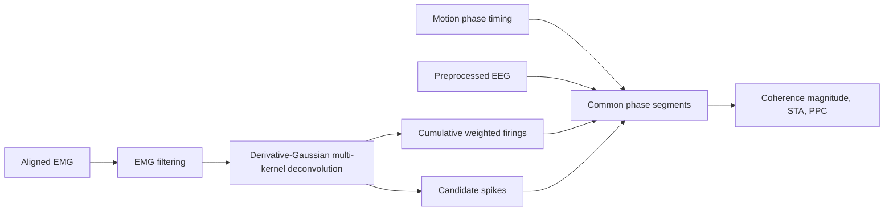

# Exploratory EEG-MUAP Spike-Field Analysis

**Testing the interpretability of EMG-derived firing patterns against synchronized EEG.**

This undergraduate project explores whether single-channel EMG deconvolution yields motor-unit-like firing patterns with interpretable cortical relationships. It compares two kernel models and examines EEG-cumulative weighted firing (CWF) coherence, spike-triggered averages (STA), and pairwise phase consistency (PPC).

**Scope: one representative participant/recording; results were inconclusive.** The components are model-derived signals, not validated individual motor-unit spike trains. No MU-specific neural decoder or consistent EEG-MUAP phase locking was established.

## Research contribution

Sing-Hao Wang primarily implemented the code, assembled the workflow, analyzed the results, and prepared the research presentation. Dr. Tsai contributed clinical interpretation of the MUAP study. These roles were confirmed by the project owner. The contribution is implementation, integration, and critical evaluation; external algorithms and validated single-motor-unit decomposition are not claimed as original outcomes.

## Experimental context and methodology

The setup combined 32-channel EEG at 500 Hz, eight bilateral lower-limb sEMG channels at 1000 Hz, and four-camera markerless motion capture at 30 Hz. The wider cohort contained 15 healthy participants; these results are a case-level methodological exploration. Four-phase support in the code does not demonstrate validated results for every movement phase.



- **Single innervation zone / multiple conduction velocities:** three kernels (`single`).
- **Multiple innervation zones:** two opposite-polarity kernels (`multi`).
- **Reported spike retrieval:** 97th-percentile amplitude threshold and 30 ms minimum ISI; additional thresholds and exclusions are configurable.
- **Preserved conventions:** coherence is `sqrt(magnitude-squared coherence)`; PPC is clipped to `[0, 1]`. See [Methods](docs/METHODS.md).

## Results and interpretation

The following means are transcribed from the supplied brief's account of report Table 6.1. They have not been recomputed from the recording. No standard errors, significance, or aggregation details are inferred.

| EEG band | Reported mean EEG-CWF coherence |
| --- | ---: |
| Delta | 0.352 |
| Theta | 0.352 |
| Alpha | 0.366 |
| Beta | 0.370 |
| Low Gamma | 0.367 |

These closely spaced means offer weak band-specific discrimination. The report describes modest STA fluctuations without pronounced band-specific spike-triggered patterns. PPC was near zero for most combinations, with isolated values around 0.35-0.377. The selected PPC figures support this descriptive observation, not a significance claim.

### Representative figures

**Input and kernel units:** device EMG is measured in μV. The owner confirmed that the mathematically generated kernels received no additional amplitude calibration. Their original μV axes are preserved, but kernel height is a model scale, not a calibrated individual motor-unit voltage.


**Three-kernel model (source Fig. 6.1a).** Left panels show derivative-Gaussian kernels; right panels show model-derived firing-pattern coefficients for LBF. This illustrates the implementation and its component structure, not validated individual motor-unit recovery.


**Two-kernel model (source Fig. 6.1b).** Opposite-polarity kernels illustrate the alternative innervation-zone model. Component labels do not establish distinct physiological motor units.


**Candidate spike retrieval (source Fig. 6.2).** LBF = left biceps femoris. Threshold, raster, and ISI plots illustrate an algorithm output, not ground-truth motor-unit identification. The source's rate uses the detected-spike time span rather than the full recording duration.


**PPC, three-kernel model (source Fig. 6.4a).** STS, electrode Cz. Columns are EMG channel/components; `n` counts sampled spike phases, not participants. Values follow the clipped PPC convention. Isolated higher cells do not establish consistent phase locking.

The [complete results gallery](docs/RESULTS.md) includes both PPC models and both STA figures. The owner confirmed that STA uses a shared display range across different extraction windows: its displayed x-axis cannot be used to compare actual peak latencies across bands. Beta is 12-30 Hz and Low Gamma is 30-46 Hz in these analyses. [Figure provenance](docs/FIGURES.md) records the originals and their interpretation notes.

## Repository guide

| Location | Role |
| --- | --- |
| [EEG_preprocessing/](EEG_preprocessing/) | MATLAB EEG class and manual ICA example |
| [tool_kits/movement_state_detector.py](tool_kits/movement_state_detector.py) | Motion detection and multimodal alignment route |
| [tool_kits/EMG_to_MUAP.py](tool_kits/EMG_to_MUAP.py) | Filtering, kernel estimation, IRLS/LSMR deconvolution, and CWF |
| [tool_kits/firing_pattern_to_spikes.py](tool_kits/firing_pattern_to_spikes.py) | Candidate spike retrieval and diagnostics |
| [tool_kits/neural_data_movement_segmentor.py](tool_kits/neural_data_movement_segmentor.py) | EEG/CWF/spike segmentation with relative time |
| [tool_kits/coherence_analysis.py](tool_kits/coherence_analysis.py) | EEG-CWF coherence magnitude |
| [tool_kits/spike_triggered_analysis.py](tool_kits/spike_triggered_analysis.py) | Main STA/PPC route |
| [docs/RESULTS.md](docs/RESULTS.md) | Complete kernel, spike, STA, PPC, and coherence presentation |
| [docs/REPRODUCIBILITY.md](docs/REPRODUCIBILITY.md) | Installation, input contract, API examples, and limits |

`movement_state_detector_v2.py` and `spike_triggered_analysis_new.py` are alternative motion/STA implementations. Their filenames do not establish them as the report's final versions. Source paths remain intact to preserve imports and provenance. There is no `eeg_emg_pipeline.py` driver in the inspected repository.

## Requirements and use

Python depends on NumPy, SciPy, pandas, Matplotlib, and seaborn:

```console
python -m venv .venv
```

Activate the environment, then run `python -m pip install -r requirements.txt`. These are research functions and environment-configured examples, not an argument-parsing CLI. Read the [API/input guide](docs/REPRODUCIBILITY.md) before running analyses. MATLAB preprocessing also requires compatible toolboxes, EEGLAB/ASR, the acquisition montage, and manual ICA review.

## Limitations and future work

Single-channel surface EMG cannot reliably unmix overlapping motor units. Kernel identities and innervation-zone assignments remain ambiguous; spike retrieval depends on thresholds and exclusions. Scalp EEG and a single motor unit operate at different spatial scales. The case-level design, source/report correspondence, clipped PPC, and STA display-axis issue further limit interpretation.

HD-EMG, validated decomposition such as gCKC-based approaches, sensitivity analysis, and broader participant validation remain future work, not implemented outcomes.

## Attribution and references

Source: Sing-Hao Wang, *Toward Digital Twin-Centered Human-Exoskeleton Collaboration: From Multi-Resolution Corticomuscular Coupling Analyses to an Incremental Mixture-of-Experts Locomotion Controller*, undergraduate capstone report, June 2026, Chapter 6, pp. 53-61, as summarized in the supplied brief.

See [Attribution](docs/ATTRIBUTION.md), [Verification](docs/VERIFICATION.md), and [Data/publication notes](docs/DATA_AND_PUBLICATION.md). Related project: [EEG-muscle-synergies-analysis](https://github.com/stephen0701/EEG-muscle-synergies-analysis).
