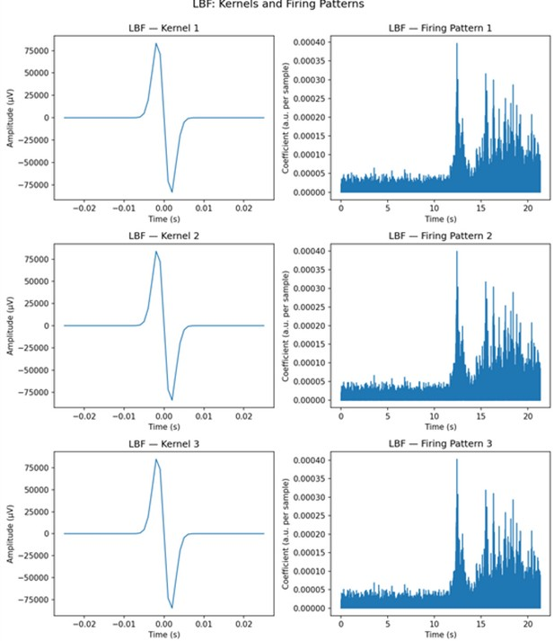
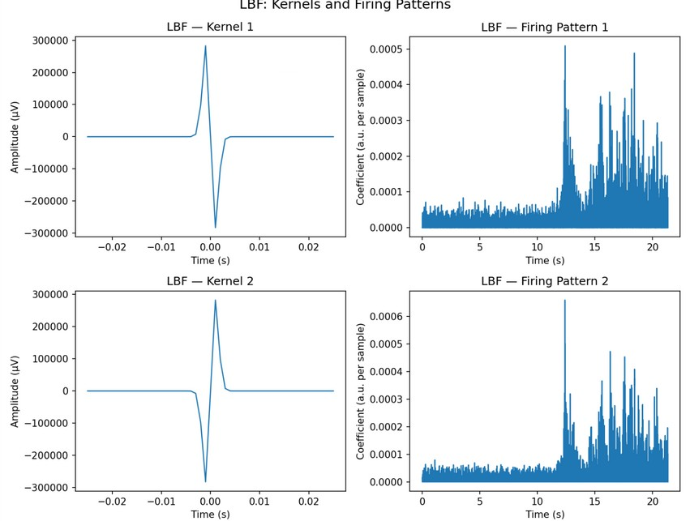
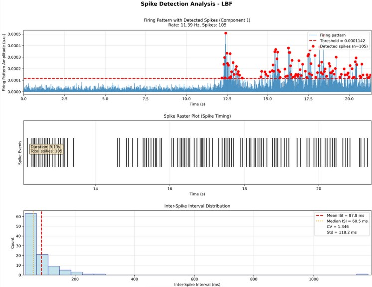
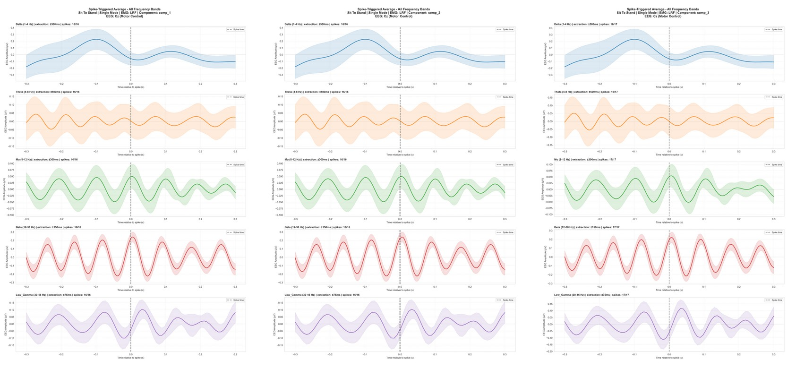
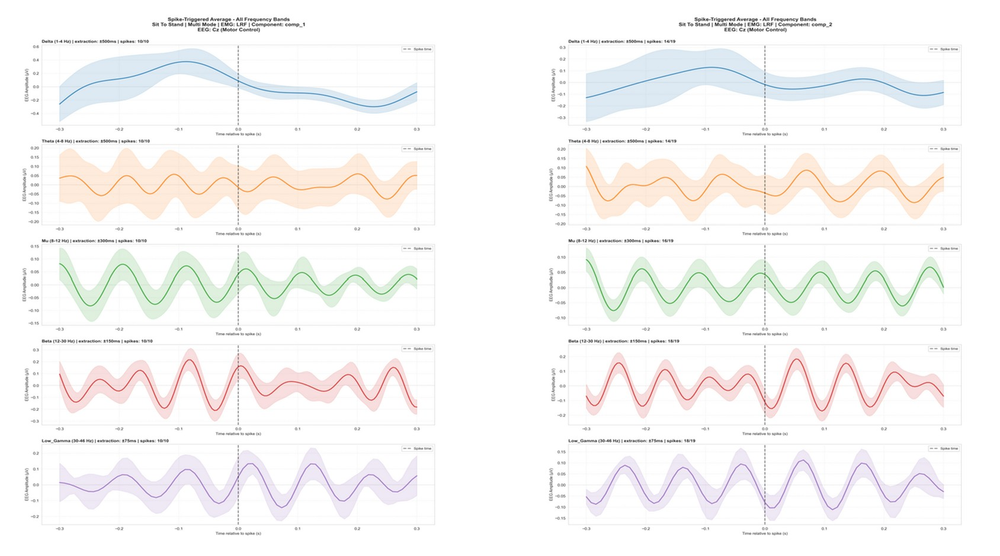
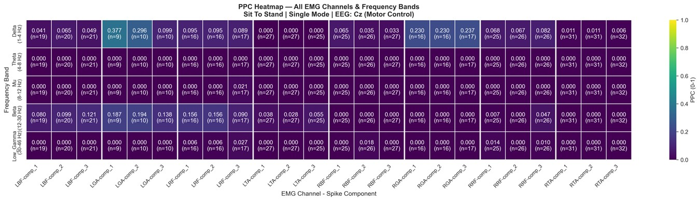
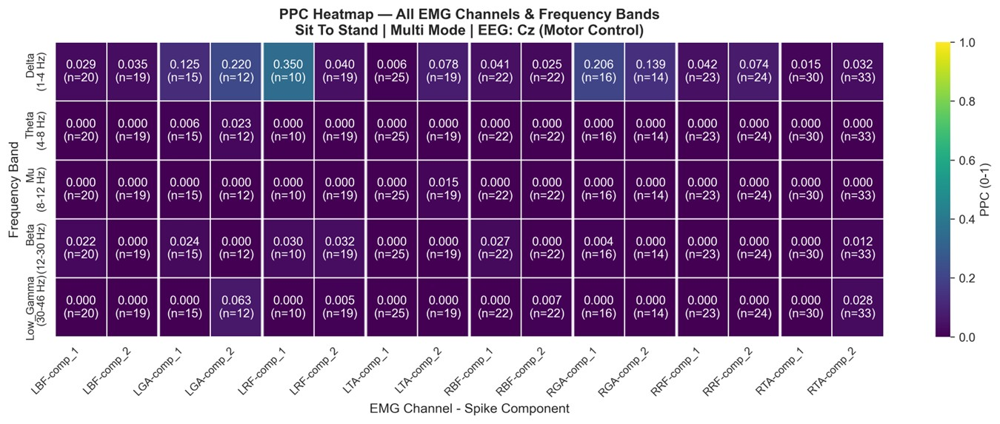

# Results and figure gallery

[README](../README.md) · [Methods](METHODS.md) · [Results](RESULTS.md) · [Reproduction](REPRODUCIBILITY.md) · [Project notes](PROJECT_NOTES.md)

This gallery preserves all seven Chapter 6 figures. The study explores one representative participant/recording. Model components and candidate spikes are not validated individual motor units. The author confirmed that device EMG is measured in microvolts, kernel amplitudes received no additional calibration, and STA used a common display axis across frequency-specific windows. The figures were not regenerated.

## 1. Two kernel models and recovered firing patterns

**Unit clarification for Figs. 6.1a/b:** the device's EMG input is in μV. The kernels are generated mathematically and their amplitudes were not independently calibrated to measured individual MUAP voltages. The original kernel axes retain the μV label, but kernel height should be interpreted as a model scale, not a calibrated motor-unit voltage. Reconstruction coefficients absorb the kernel scaling; component height does not identify a physiological motor unit.

**Fig. 6.1a — Single innervation zone / multiple conduction velocities.** The three-kernel model (`single`) is illustrated for LBF, left biceps femoris. Left panels show kernels, right panels show recovered firing-pattern coefficients. The components illustrate the deconvolution model, not ground-truth motor-unit separation.

**Fig. 6.1b — Multiple innervation zones.** The two-kernel model (`multi`) uses opposite-polarity kernels. This figure supports comparison of model constructions; it does not resolve innervation-zone assignment or establish two distinct recovered motor units.

## 2. Candidate spike retrieval

**Fig. 6.2 — Candidate spike retrieval.** The report experiment uses a 97th-percentile threshold and 30 ms minimum ISI. The displayed threshold and detections illustrate an algorithm output. The source computes rate over the first-to-last detected-spike span, rather than the full plotted recording. The image alone does not recover every run parameter or establish physiological spike identities.

## 3. Spike-triggered averages

**Time-axis clarification for Figs. 6.3a/b:** the author confirmed that frequency-specific windows were mapped onto a common ±0.3 display range. The tick labels therefore **must not be interpreted as common physical spike-relative seconds across bands**. Do not compare absolute peak latency, oscillation frequency, or window duration using these displayed x-axes. The images are retained for descriptive inspection of the original analysis; a physical-lag analysis requires replotting against the actual time vectors.

| Band | Actual extraction half-window in the archived source | Common displayed range |
| --- | --- | --- |
| Delta, 1-4 Hz | ±0.5 s | ±0.3 display units |
| Theta, 4-8 Hz | ±0.5 s | ±0.3 display units |
| Mu/Alpha, 8-12 Hz | ±0.3 s | ±0.3 display units |
| Beta, 12-30 Hz | ±0.15 s | ±0.3 display units |
| Low Gamma, 30-46 Hz | ±0.075 s | ±0.3 display units |

**Fig. 6.3a — STA, three-kernel model.** STS, LRF (left rectus femoris), EEG electrode Cz. Columns show model components and rows show frequency bands. Apply the display-axis clarification above to every panel. The report describes modest fluctuations without pronounced band-specific spike-triggered patterns; the curves do not establish a consistent coupling effect.

**Fig. 6.3b — STA, two-kernel model.** The same time-axis restriction applies. Boundary rejection produces different usable spike counts for different extraction windows, so STA and PPC sample counts need not match.

## 4. Pairwise phase consistency

**Fig. 6.4a — PPC, three-kernel model.** Columns identify EMG channels/components; rows identify EEG bands. `n` counts sampled spike phases, not participants. The implementation clips PPC to `[0, 1]`, so negative finite-sample estimates appear as zero. An isolated value of 0.377 is descriptive, not a significance claim.

**Fig. 6.4b — PPC, two-kernel model.** An isolated value around 0.350 coexists with many near-zero cells. No consistent EEG-MUAP phase locking was established, and zero cells do not prove absent coupling.

## 5. Reported coherence summary

The project research summary transcribes report Table 6.1 as follows. The source uses coherence magnitude (`sqrt(MSC)`); these values are not percentage correlations or newly recomputed results. Original aggregation logs and source measurements remain unavailable.

| EEG band | Reported mean EEG-CWF coherence |
| --- | ---: |
| Delta | 0.352 |
| Theta | 0.352 |
| Alpha | 0.366 |
| Beta | 0.370 |
| Low Gamma | 0.367 |

The closely spaced means offered weak band-specific discrimination. The study remains an inconclusive methodological exploration. See [Methods](METHODS.md), [Reproduction](REPRODUCIBILITY.md), and [Figure provenance](FIGURES.md) for implementation and evidence limits.
